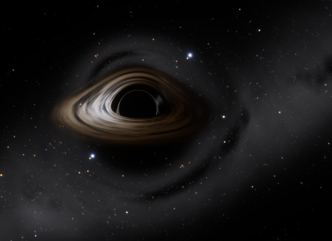

# Demos

Here are some of my stand-alone demos and prototypes, mostly in HTML, and
mostly focused on 3D rendering and proceural generation.

I like to optimize things and do all my dev work and (most of) my testing on an
old laptop with an integrated HD 5500 GPU, and I find that running on
underpowered hardware pushes you (and AI models) to optimize more.

All the low-level coding is done by AI (usually Claude) unless otherwise
specified.

## Black hole

A physics-based black hole renderer, made fast with geometry and lookup tables.
Doing it the "math way" instead of using ray marching makes path calculations
about 40x faster, though with all other rendering included the end result is
only ~3-4x as fast as an equivalent ray marched version. But it's still good
enough to run in real-time on a phone.

- [Live demo](https://korslund.github.io/demos/blackhole/)
- [Source / README](https://github.com/korslund/demos/tree/main/blackhole)

