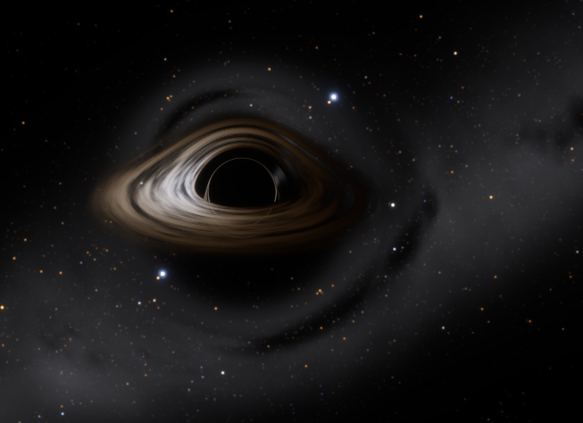
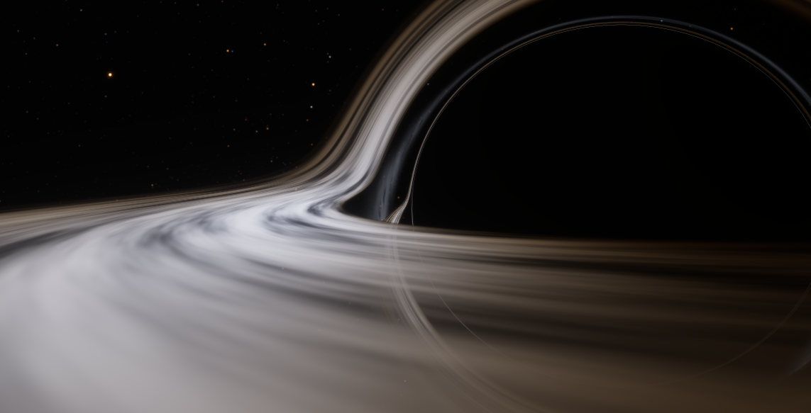
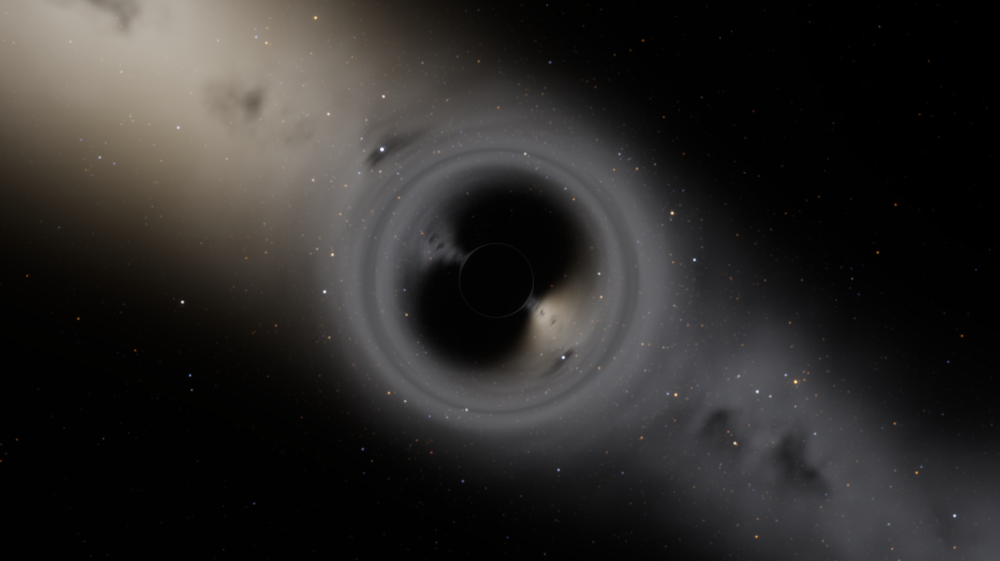
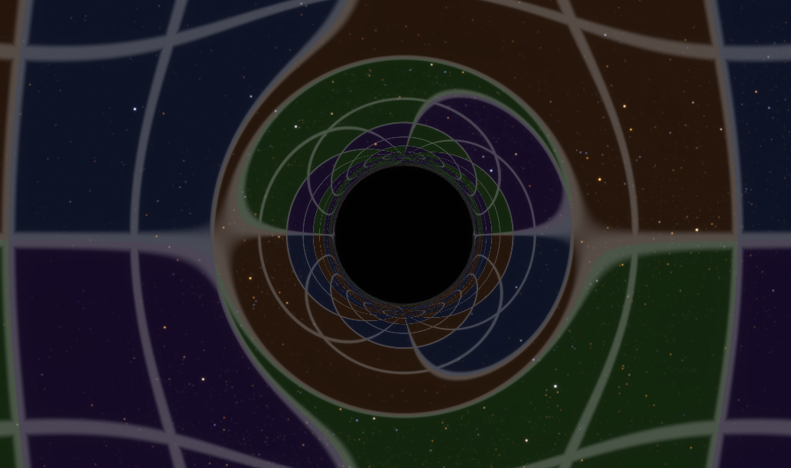
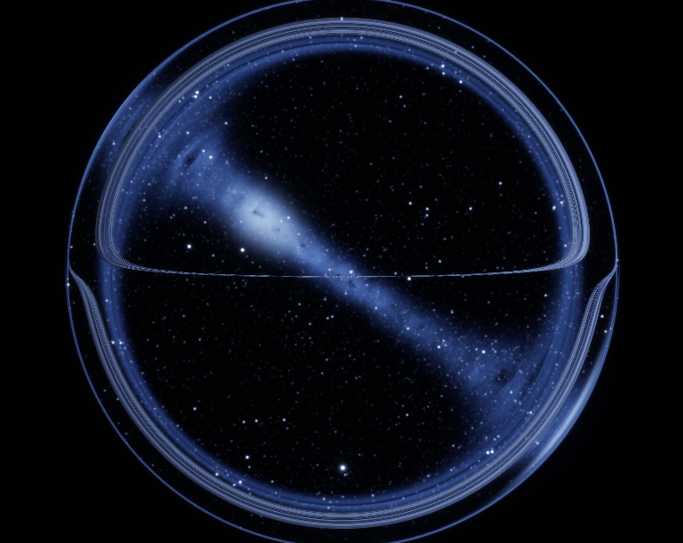

# Fast black hole rendering

[Live demo](https://korslund.github.io/demos/blackhole)

A fast black hole renderer that runs in a browser using WebGL2.

## Features

- Physically accurate lensing using analytic general relativity.
- Fast; runs in real-time on old hardware and phones by using lookups instead
  of ray marching.
- Procedurally generated background galaxy and stars.
- Basic accretion disk that can be turned on/off.
- Move down to the horizon until the outside world becomes a tiny
  blueshifted circle.
- License: MIT

## Screenshots

|||
|---|---|
|  |  |
|  |  |

## Physics and rendering details

- Geometry largely follows a 2020 paper by Eric Bruneton [1]. Since
  non-rotating black holes are always perfect spheres, all light paths
  (geodesics) can be reduced to a function of just two variables. That function
  can then be precomputed at startup (sampled non-linearly to remain well
  resolved at critical points [2]) and stored in a 2D texture, making runtime
  lookup extremely cheap.
- **Stars:** forward-mapped star sprites [3] means a single star can appear up
  to 4 times around the black hole, each at the correct location and
  magnification and with no blurring.
- **Accretion disk:** a thin Keplerian disk, Doppler-shifted so the approaching
  side (left) is bluer and brighter while the other side is redshifted. [4] [5]
- Procedural background galaxy baked into a static cubemap skybox.
- Blackbody color table [6]. Bloom/glare [7],[8]. ACES tonemaps [9].

## Limitations

- Designed as a stand-alone renderer. Putting this into a larger Space Engine
  style universe simulation is possible but will require some extra work.
- The accretion disk texture isn't very fancy or plausible. See Bruneton's
  original [1] for something that looks a bit more cinematic. The background
  stars/galaxy are just placeholders.
- A rotating (Kerr) black hole would more realistic, but that breaks the nice
  spherical symmetry properties of the problem and requires changes to the main
  algorithm. I would still work but would be a bit more messy.

## Credits and work

Physics and code was done using Opus 5.5 (high effort). I had the original idea
of using spherical symmetry and dimensional reduction to make a cheap
analytical path solver without ray tracing. We then found Bruneton's 2020 paper
which essentially had the exact same idea except even better (also baking in
camera position), so we basically just copied his notes. A few other
suggestions were added by Claude, like the forward-mapped stars [3].

Effort and time: ~1 week

## References

1. E. Bruneton (2020), *Real-time High-Quality Rendering of Non-Rotating Black Holes*, arXiv:2010.08735. The table approach, disk crossings, blackbody disk and glare. https://github.com/ebruneton/black_hole_shader
2. V. Bozza (2002), *Gravitational lensing in the strong field limit*, Phys. Rev. D 66, 103001.
3. T. Müller, D. Weiskopf (2010), *Distortion of the stellar sky by a Schwarzschild black hole*, Am. J. Phys. 78, 204. Forward-mapped stars.
4. J.-P. Luminet (1979), *Image of a spherical black hole with thin accretion disk*, Astron. Astrophys. 75, 228.
5. N. Shakura, R. Sunyaev (1973); I. Novikov, K. Thorne (1973): the thin-disk temperature profile.
6. C. Wyman, P.-P. Sloan, P. Shirley (2013), *Simple Analytic Approximations to the CIE XYZ Color Matching Functions*, JCGT 2(2).
7. G. Spencer, P. Shirley, K. Zimmerman, D. Greenberg (1995), *Physically-based glare effects for digital images*, SIGGRAPH 95.
8. J. Jimenez (2014), *Next Generation Post Processing in Call of Duty: Advanced Warfare* (SIGGRAPH course): the bloom chain.
9. K. Narkowicz (2015), *ACES Filmic Tone Mapping Curve*.