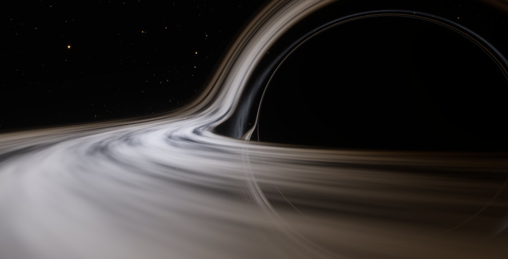
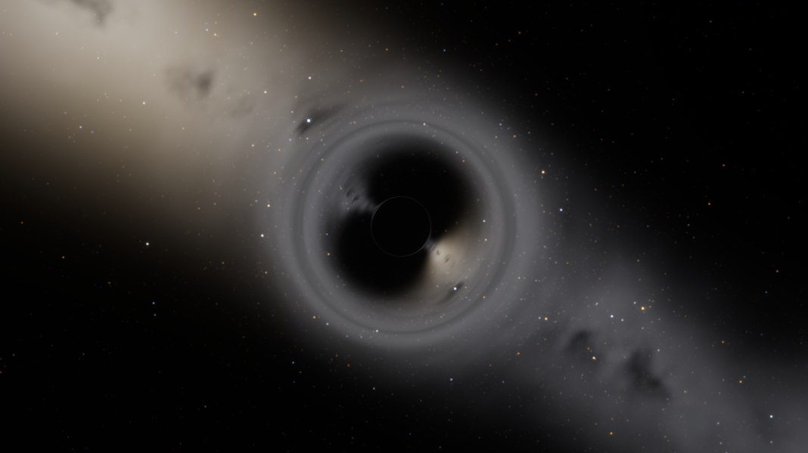
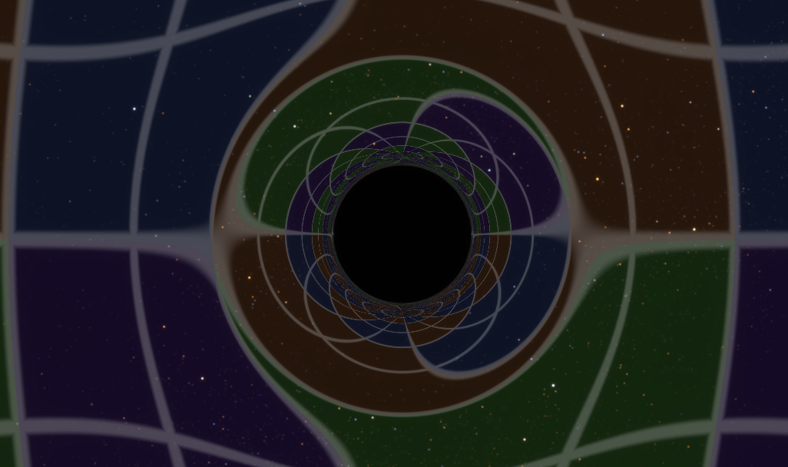
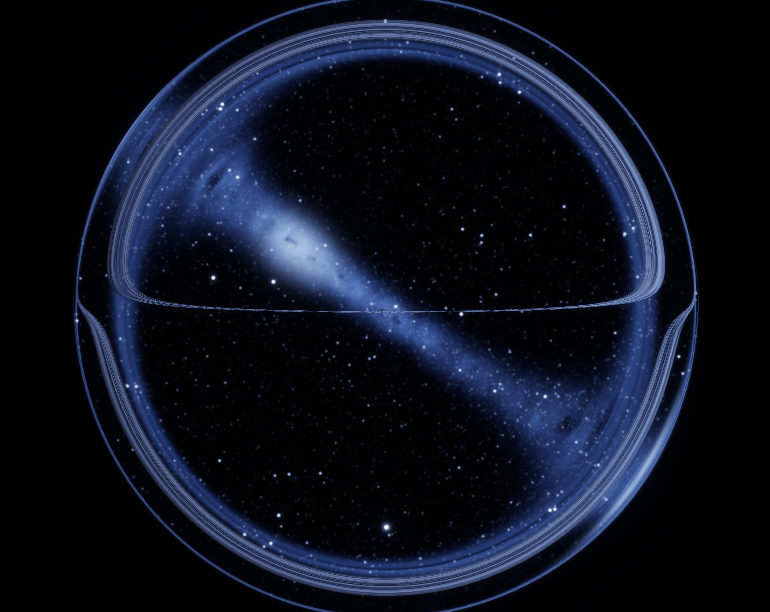

# Fast black hole rendering

## Demo

**[Live demo](https://korslund.github.io/demos/blackhole)**

## Features

- **Physically accurate geometry and lensing** using fast table lookups.
- **Runs in a browser** using WebGL.
- **Extremely fast.** Runs in real-time on phones and old laptops.
- **Move down to the horizon** until the outside world becomes a tiny
  blueshifted circle.
- Procedurally generated background galaxy and stars.
- Accretion disk, galaxy, stars can be turned off.
- License: MIT

## Screenshots

| | |
|---|---|
|  |  |
|  |  |

## Physics

- **Geometry:** largely follows a 2020 paper by Eric Bruneton [1]. Since
  non-rotating black holes are always perfect spheres, all paths can be reduced
  to a function of just two variables. That function can then be precomputed at
  startup (sampled non-linearly to remain well resolved at critical points [2])
  and stored in a 2D texture, making runtime lookup extremely cheap.

- **Stars:** forward-mapped star sprites [3] means a single star can appear up
  to 4 times around the black hole, each at the correct location and
  magnification and with no smearing.

- **Accretion disk:** a thin Keplerian disk, Doppler-shifted so the approaching
  (left) side is bluer and brighter while the other side is redshifted. [4] [5]

## Rendering

- Procedural Milky Way baked into a cubemap, so the sky costs practically
  nothing.

- Colors: blackbody color table ([6]), bloom/glare ([7],[8]). Claude also
  really likes to put ACES tonemaps into everything [9].

## Limitations

- Designed as a stand-alone renderer. Putting this into a larger Space Engine
  style universe simulation is possible but will require some extra work.

- The accretion disk texture isn't very fancy or plausible, and the background
  stars/galaxy are just placeholders.

- A rotating (Kerr) black hole would more realistic, but that breaks the
  symmetry and requires changes to the main algorithm.

## Credits

Physics and code by Opus 5.5

Ideas and testing by Nicolay Korslund

## References

1. E. Bruneton (2020), *Real-time High-Quality Rendering of Non-Rotating Black Holes*, arXiv:2010.08735. The table approach, disk crossings, blackbody disk and glare.
2. V. Bozza (2002), *Gravitational lensing in the strong field limit*, Phys. Rev. D 66, 103001.
3. T. Müller, D. Weiskopf (2010), *Distortion of the stellar sky by a Schwarzschild black hole*, Am. J. Phys. 78, 204. Forward-mapped stars.
4. J.-P. Luminet (1979), *Image of a spherical black hole with thin accretion disk*, Astron. Astrophys. 75, 228.
5. N. Shakura, R. Sunyaev (1973); I. Novikov, K. Thorne (1973): the thin-disk temperature profile.
6. C. Wyman, P.-P. Sloan, P. Shirley (2013), *Simple Analytic Approximations to the CIE XYZ Color Matching Functions*, JCGT 2(2).
7. G. Spencer, P. Shirley, K. Zimmerman, D. Greenberg (1995), *Physically-based glare effects for digital images*, SIGGRAPH 95.
8. J. Jimenez (2014), *Next Generation Post Processing in Call of Duty: Advanced Warfare* (SIGGRAPH course): the bloom chain.
9. K. Narkowicz (2015), *ACES Filmic Tone Mapping Curve*.